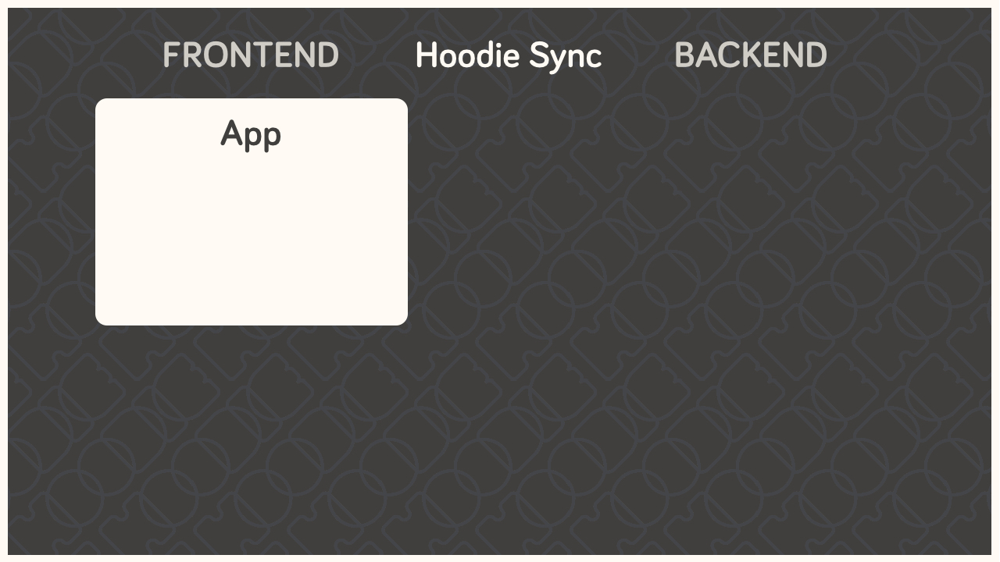
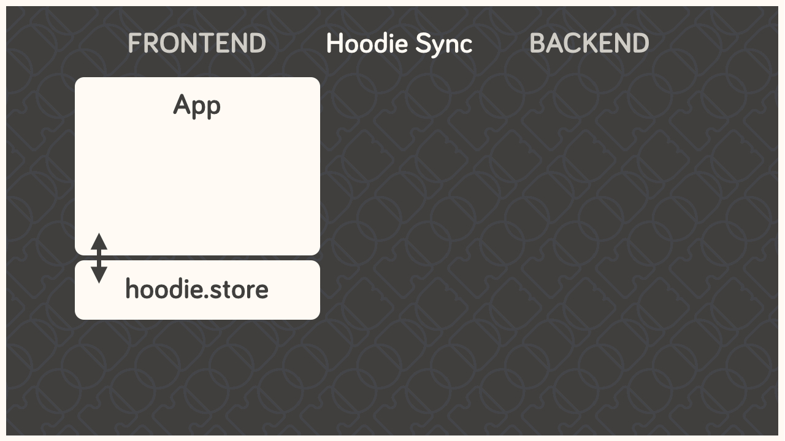
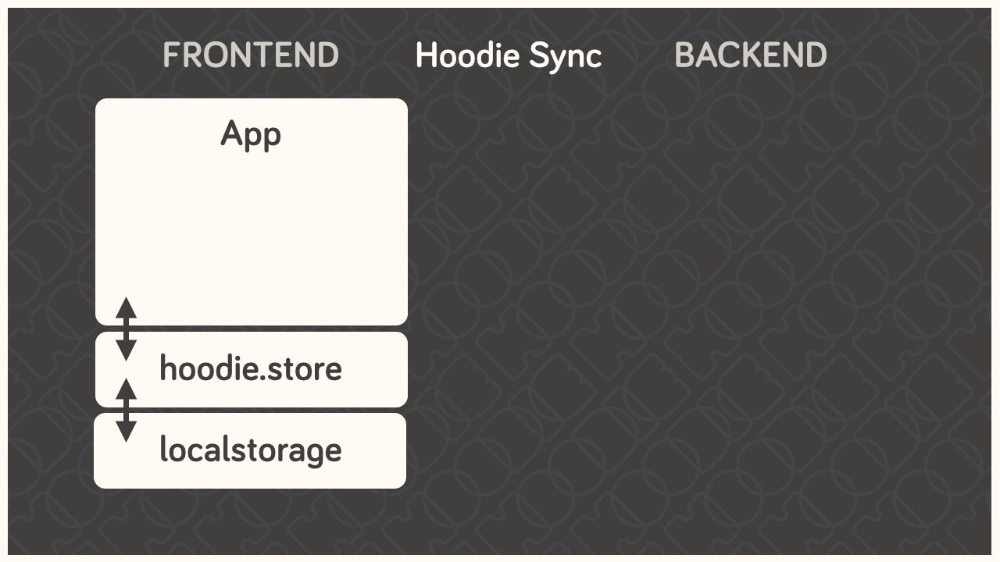
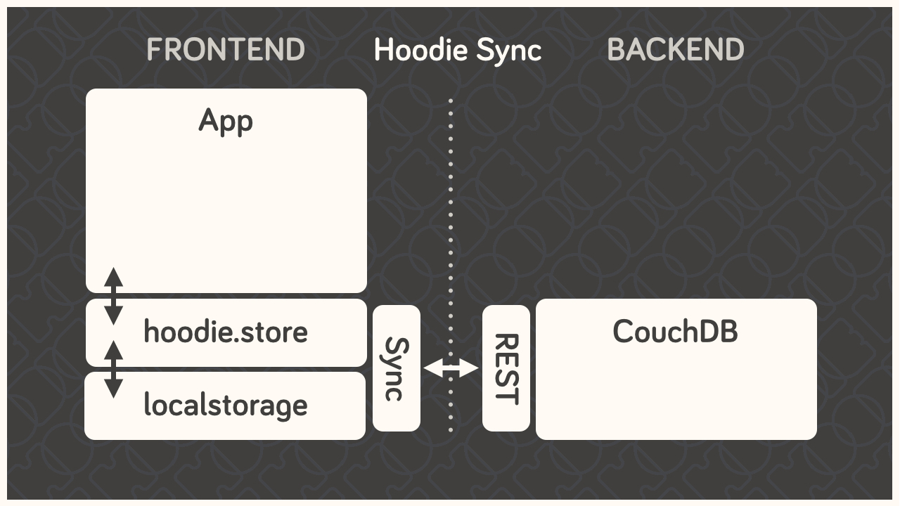
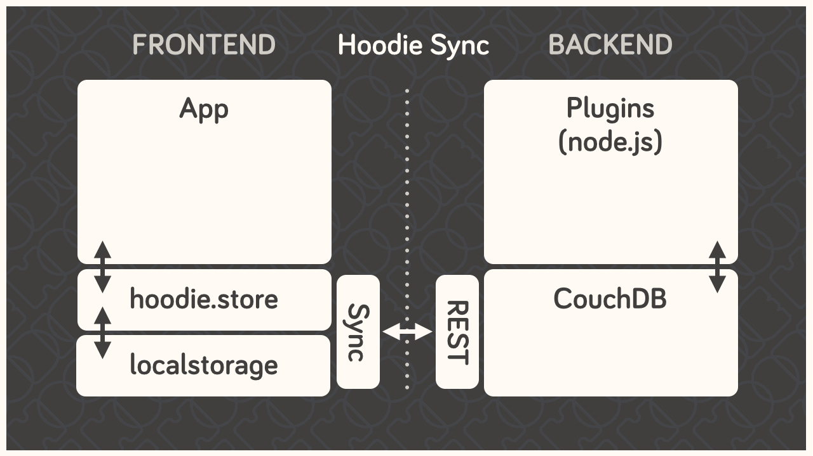

Como o Hoodie funciona
================

O Hoodie conta com diversos componentes que trabalham em conjunto, de uma maneira um tanto atípica, para cumprir nossa promessa de simplicidade, sincronização pronta para uso e capacidade de funcionamento offline.

Tudo começa no frontend, com o seu aplicativo. É nele que ficam a interface do usuário, a lógica de negócios do lado do cliente, entre outros elementos.

O código do aplicativo comunica-se apenas com a API de frontend do Hoodie; nunca diretamente com o código do lado do servidor, com o banco de dados ou, sequer, com o armazenamento no navegador.

O Hoodie utiliza o PouchDB para armazenar dados localmente; este, por sua vez, recorre ao IndexedDB ou ao WebSQL, conforme o que estiver disponível. O Hoodie salva todos os dados nesse local primeiramente, antes de realizar qualquer outra operação. Portanto, caso você esteja offline, seus dados permanecem armazenados localmente de forma segura.

Isso, por si só, já é o suficiente para um aplicativo. Mas, se você quiser salvar seus dados remotamente ou enviar um e-mail, por exemplo, precisará de um pouco mais. O Hoodie utiliza o CouchDB, um banco de dados que realiza replicação. Nós o usamos para sincronizar dados entre o servidor e os clientes — algo em que o CouchDB é, por sinal, muito eficiente.

*Um breve parêntese: no CouchDB, cada usuário possui seu próprio banco de dados privado, ao qual apenas ele tem acesso; portanto, todos os dados do usuário são privados por padrão. Eles podem ser tornados públicos, caso o usuário assim decida, mas isso não pode acontecer por acidente. É por esse motivo que, frequentemente, tratamos o compartilhamento e os dados globais como uma funcionalidade à parte.* Por trás do banco de dados, encontra-se o código do servidor propriamente dito, estruturado como um núcleo (core) compacto em Node.js, acompanhado por diversos plugins. Esses componentes operam sobre os dados armazenados no CouchDB, que, por sua vez, replica as alterações para os clientes.

Assim, o Hoodie adota a estrutura **cliente ↔ banco de dados ↔ servidor**, em vez da tradicional **cliente ↔ servidor ↔ banco de dados** — e é daí que surgem muitos dos seus "superpoderes". O grande diferencial está representado pela linha pontilhada no meio: a conexão entre os clientes e o servidor pode ser interrompida a qualquer momento sem comprometer o sistema. O *frontend* e o *backend* nunca se comunicam diretamente; eles apenas deixam mensagens e tarefas um para o outro. Tudo é estruturado com um baixo acoplamento, baseado em eventos e projetado para alcançar a consistência eventual.
